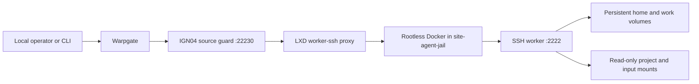
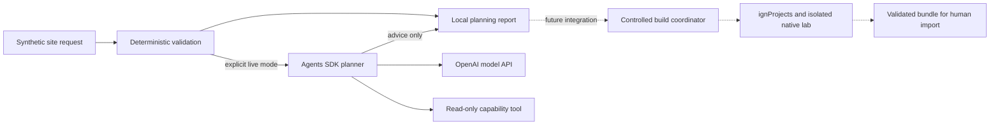

# Architecture

## Deployed access path, October 13

Warpgate reaches IGN04 at `10.20.1.4:22230`. The LXD proxy forwards to jail loopback `127.0.0.1:22230`, where rootless Docker publishes container port 2222. The host ingress guard accepts only source `10.20.0.20` at that destination. These are historical deployment values, not portable defaults to apply to another machine.

The worker runs UID 1000/GID 0. Its root filesystem and reference inputs are read-only. Named volumes persist home, work and SSH host keys. The service and workload currently share an identity, which exposed the worker's host private key to the workload. LXD and Docker share the host kernel.

## New starter

Solid starter paths are implemented locally. Dotted paths are missing integration. The starter was not installed in the deployed worker during repository preparation. The worker's historical Codex-derived image does not prove the Python Agents SDK is installed there.

The operator's Warpgate token and the planner's OpenAI credential serve different systems. No token is included in the repository. The general command/file-transfer client is an operator utility and is not an agent tool.
